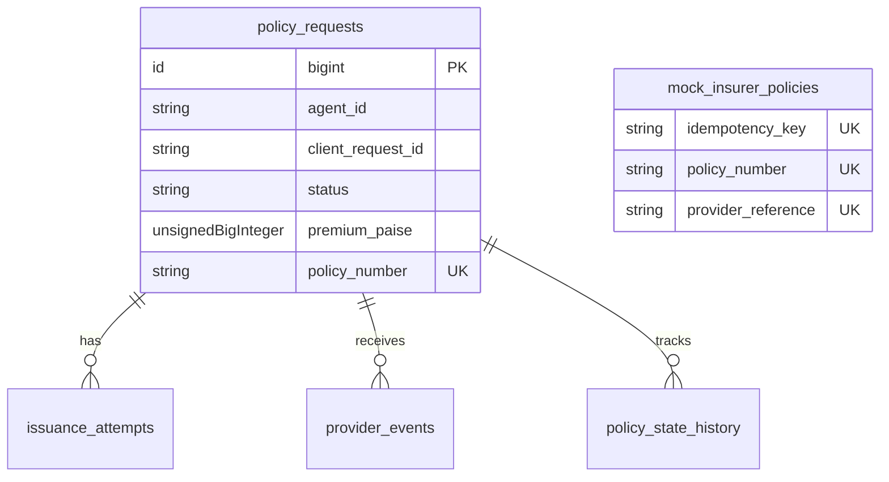
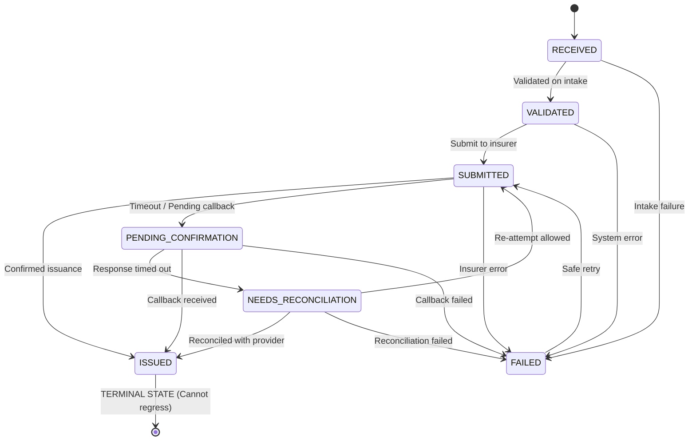

# PolicyFlow — Fault-Tolerant Insurance Issuance & Reconciliation Engine

A robust, fault-tolerant travel insurance policy issuance and reconciliation backend built with **PHP 8.3** and **Laravel 11/13**. Designed to safely process insurance purchase requests from travel agents, enforce deterministic decimal-safe pricing, prevent duplicate policies, manage state machine transitions, and reconcile uncertain outcomes from unreliable mock insurers.

---

## 1. Project Purpose & Overview

In travel insurance distribution, upstream travel agents submit policy purchase requests to downstream insurers whose APIs are often unreliable:
- Requests can time out after an insurer has internally issued a policy.
- Network retries can cause duplicate policy creation.
- Webhook callbacks can arrive late, out of order, or repeated.

**PolicyFlow** solves these challenges by implementing:
1. **Idempotent Intake:** Natural composite uniqueness (`agent_id` + `client_request_id`) at both the application and database levels.
2. **Deterministic Financial Math:** Zero-drift decimal-safe pricing calculated in integer paise.
3. **Strict Finite State Machine:** Explicit, forward-only transitions preventing regressions (e.g., `ISSUED` cannot be reverted).
4. **Idempotent Mock Insurer:** Deterministic provider simulation with persistent policy storage.
5. **Reconciliation Engine:** Safe lookup mechanism to recover policies from uncertain timeout states without reissuing.
6. **Callback Deduplication:** Unique event tracking preventing duplicate webhook processing.

---

## 2. Features Implemented

- **Policy Intake API:** `POST /api/policy-requests` with 422 validation, 201 for fresh creations, and 200 for idempotent re-deliveries.
- **Decimal-Safe Pricing Engine:** Base rates, age brackets, destination multipliers, coverage multipliers in integer paise.
- **Policy Submission API:** `POST /api/policy-requests/{id}/submit` with scenario simulation (`SUCCESS`, `TEMPORARY_FAILURE`, `TIMEOUT_AFTER_ISSUE`, `DELAYED_CALLBACK`).
- **Reconciliation API:** `POST /api/policy-requests/{id}/reconcile` to safely query the insurer and recover orphan policies.
- **Provider Callback API:** `POST /api/mock-insurer/callback` with duplicate event protection.
- **Policy Retrieval & Listing:** `GET /api/policy-requests/{id}` with full audit history, and `GET /api/policy-requests` with pagination and status filtering.
- **Automated Test Suite:** 20 automated tests (96 assertions) covering all acceptance criteria and reliability scenarios.

---

## 3. Technology Stack

- **Language:** PHP 8.3+
- **Framework:** Laravel 11/13
- **Database:** SQLite (default for zero-config local run) or MySQL 8+ / PostgreSQL
- **Testing:** PHPUnit 12
- **Version Control:** Git

No external paid services, Redis, or heavy third-party queues required. The application runs self-contained out-of-the-box.

---

## 4. Prerequisites

Verify PHP and Composer are installed:

```bash
php -v        # PHP 8.2 or 8.3+
composer -V   # Composer 2.x
```

Required PHP extensions: `pdo_sqlite` (or `pdo_mysql`), `mbstring`, `openssl`, `curl`, `fileinfo`, `zip`.

---

## 5. Quick Installation & Setup

```bash
# 1. Clone repository
git clone <repository-url>
cd policyflow

# 2. Install dependencies
composer install

# 3. Setup environment configuration
cp .env.example .env

# 4. Generate application key
php artisan key:generate

# 5. Run database migrations
php artisan migrate

# 6. Run automated test suite
php artisan test
```

---

## 6. Environment Configuration

The provided `.env.example` is preconfigured for zero-setup local execution with SQLite:

```env
APP_NAME=PolicyFlow
APP_ENV=local
APP_KEY=base64:...
APP_DEBUG=true
APP_URL=http://localhost:8000

DB_CONNECTION=sqlite
```

If you prefer **MySQL 8+**, simply update `.env`:
```env
DB_CONNECTION=mysql
DB_HOST=127.0.0.1
DB_PORT=3306
DB_DATABASE=policyflow
DB_USERNAME=root
DB_PASSWORD=your_password
```

---

## 7. Running the Application

Start Laravel's built-in development server:

```bash
php artisan serve
```

The API will be accessible at `http://127.0.0.1:8000`.

---

## 8. Running Automated Tests

Run the full PHPUnit test suite:

```bash
php artisan test
```

For test names and detailed specifications:

```bash
php artisan test --testdox
```

Expected result: **20 tests passed, 96 assertions**.

---

## 9. API Specification & Endpoints

### Summary of Endpoints

| Method | Endpoint | Description | Status Codes |
|---|---|---|---|
| `POST` | `/api/policy-requests` | Intake policy request (idempotent) | `201`, `200`, `422` |
| `GET` | `/api/policy-requests/{id}` | Retrieve request with audit trail | `200`, `404` |
| `GET` | `/api/policy-requests` | List requests with pagination & status filter | `200` |
| `POST` | `/api/policy-requests/{id}/submit` | Submit request for issuance | `200`, `404`, `409` |
| `POST` | `/api/policy-requests/{id}/reconcile` | Reconcile uncertain request with insurer | `200`, `404` |
| `POST` | `/api/mock-insurer/callback` | Ingest webhook event from insurer | `200`, `404`, `422` |

---

### Endpoint Details & Examples

#### 1. Policy Request Intake: `POST /api/policy-requests`

**Request Body:**
```json
{
  "client_request_id": "AGT-2026-0001",
  "agent_id": "AGENT-17",
  "customer_name": "Sample Customer",
  "date_of_birth": "1998-04-10",
  "destination": "INTERNATIONAL",
  "trip_start": "2026-11-10",
  "trip_end": "2026-11-14",
  "plan_code": "PLUS",
  "sum_insured": 300000
}
```

**Response (HTTP 201 Created — Initial Submission):**
```json
{
  "success": true,
  "message": "Policy request created successfully",
  "data": {
    "id": 1,
    "client_request_id": "AGT-2026-0001",
    "agent_id": "AGENT-17",
    "customer_name": "Sample Customer",
    "date_of_birth": "1998-04-10",
    "destination": "INTERNATIONAL",
    "trip_start": "2026-11-10",
    "trip_end": "2026-11-14",
    "plan_code": "PLUS",
    "sum_insured": 300000,
    "premium": 225.00,
    "status": "VALIDATED",
    "policy_number": null,
    "provider_reference": null,
    "attempt_count": 0,
    "created_at": "2026-10-23T15:20:00.000000Z",
    "updated_at": "2026-10-23T15:20:00.000000Z"
  }
}
```

**Response (HTTP 200 OK — Duplicate Submission):**
```json
{
  "success": true,
  "message": "Existing policy request returned",
  "data": {
    "id": 1,
    "client_request_id": "AGT-2026-0001",
    "agent_id": "AGENT-17",
    "customer_name": "Sample Customer",
    "premium": 225.00,
    "status": "VALIDATED"
  }
}
```

---

#### 2. Submit for Issuance: `POST /api/policy-requests/{id}/submit`

**Request Body:**
```json
{
  "scenario": "SUCCESS"
}
```
*(Scenarios: `SUCCESS`, `TEMPORARY_FAILURE`, `TIMEOUT_AFTER_ISSUE`, `DELAYED_CALLBACK`)*

**Response (HTTP 200 OK):**
```json
{
  "success": true,
  "message": "Policy issued successfully",
  "data": {
    "id": 1,
    "status": "ISSUED",
    "policy_number": "POL-9A3X8K21",
    "provider_reference": "REF-7G5K12",
    "premium": 225.00,
    "attempt_count": 1
  }
}
```

---

#### 3. Reconcile Policy: `POST /api/policy-requests/{id}/reconcile`

Used when a submission timed out (`NEEDS_RECONCILIATION`).

**Response (HTTP 200 OK):**
```json
{
  "success": true,
  "message": "Policy successfully recovered from provider.",
  "data": {
    "id": 1,
    "status": "ISSUED",
    "policy_number": "POL-7B29F41C"
  }
}
```

---

#### 4. Provider Callback: `POST /api/mock-insurer/callback`

**Request Body:**
```json
{
  "event_id": "EVT-2026-88910",
  "policy_request_id": 1,
  "event_type": "POLICY_ISSUED",
  "policy_number": "POL-CALLBACK-98765",
  "provider_reference": "REF-CB-12345"
}
```

**Response (HTTP 200 OK):**
```json
{
  "success": true,
  "message": "Callback processed successfully",
  "data": {
    "event_id": "EVT-2026-88910",
    "policy_request": 1,
    "new_status": "ISSUED"
  }
}
```

---

#### 5. Retrieve Request & Audit Trail: `GET /api/policy-requests/{id}`

**Response (HTTP 200 OK):**
```json
{
  "success": true,
  "data": {
    "id": 1,
    "client_request_id": "AGT-2026-0001",
    "agent_id": "AGENT-17",
    "customer_name": "Sample Customer",
    "destination": "INTERNATIONAL",
    "plan_code": "PLUS",
    "sum_insured": 300000,
    "premium": 225.00,
    "status": "ISSUED",
    "policy_number": "POL-9A3X8K21",
    "provider_reference": "REF-7G5K12",
    "state_history": [
      {
        "previous_state": null,
        "new_state": "RECEIVED",
        "reason": null
      },
      {
        "previous_state": "RECEIVED",
        "new_state": "VALIDATED",
        "reason": "Request validated on intake"
      },
      {
        "previous_state": "VALIDATED",
        "new_state": "SUBMITTED",
        "reason": "Submitting to insurer"
      },
      {
        "previous_state": "SUBMITTED",
        "new_state": "ISSUED",
        "reason": "Policy issued by insurer"
      }
    ],
    "issuance_attempts": [
      {
        "attempt_number": 1,
        "status": "SUCCESS",
        "provider_reference": "REF-7G5K12",
        "response_summary": "Policy issued successfully"
      }
    ]
  }
}
```

---

## 10. Pricing Rules & Formula

### Formula
$$\text{premium} = \text{base\_daily\_rate} \times \text{travel\_days} \times \text{age\_multiplier} \times \text{destination\_multiplier} \times \text{coverage\_multiplier}$$

### Multipliers Table
| Parameter | Rule / Category | Value / Rate |
|---|---|---|
| **Base Rate** | BASIC | ₹12 / day |
| | PLUS | ₹20 / day |
| | PREMIUM | ₹30 / day |
| **Age Multiplier** | 0–17 years | 1.10 |
| *(Age on `trip_start`)* | 18–60 years | 1.00 |
| | 61–70 years | 1.50 |
| | 71+ years | 2.00 |
| **Destination** | DOMESTIC | 1.00 |
| | INTERNATIONAL | 1.80 |
| **Sum Insured** | ₹100,000 | 1.00 |
| | ₹300,000 | 1.25 |
| | ₹500,000 | 1.50 |
| **Travel Days** | Inclusive calculation | $(\text{trip\_end} - \text{trip\_start}) + 1$ (min 1) |

### Sample Calculation (Assignment Example)
- **Customer:** DOB 1998-04-10, Trip start 2026-11-10 $\rightarrow$ Age = 28 $\rightarrow$ Age multiplier = **1.00**
- **Dates:** 2026-11-10 to 2026-11-14 $\rightarrow$ $(14 - 10) + 1$ = **5 days**
- **Plan:** PLUS $\rightarrow$ **₹20.00 / day**
- **Destination:** INTERNATIONAL $\rightarrow$ **1.80**
- **Coverage:** ₹300,000 $\rightarrow$ **1.25**
- **Calculation:**
  $$\text{premium} = 20 \times 5 \times 1.00 \times 1.80 \times 1.25 = ₹225.00$$
  *(Stored as 22,500 paise in database)*

---

## 11. Database Design & Constraints

The system uses 5 tables:



### Table Definitions & Critical Constraints
1. **`policy_requests`**
   - **Composite Unique Constraint:** `UNIQUE(agent_id, client_request_id)` enforces strict intake idempotency at the database level.
   - **Unique Index:** `UNIQUE(policy_number)` (nullable) guarantees no two requests share the same policy number.
   - Stores `premium_paise` as an unsigned integer (immutable snapshot).
2. **`issuance_attempts`**
   - Tracks attempt number, provider reference, request outcome, error details, and timestamp.
3. **`provider_events`**
   - **Unique Constraint:** `UNIQUE(provider_event_id)` ensures webhooks and callback deliveries are processed exactly once.
4. **`policy_state_history`**
   - Audit trail capturing `previous_state`, `new_state`, `reason`, and related attempt/event ID.
5. **`mock_insurer_policies`**
   - Provider-side storage simulating the insurer's separate persistent database.
   - `UNIQUE(idempotency_key)` guarantees the provider will not issue two policies for the same logical request.

---

## 12. State Machine & Transitions



**Key Safety Rules:**
- `ISSUED` has **no outgoing transitions**; once issued, it is terminal and immutable.
- Stale callbacks or retry submissions arriving after `ISSUED` return HTTP 200 with the existing issued data and do not modify state.

---

## 13. Reliability Scenarios

### Implemented & Tested Scenarios

| Scenario | Mechanism | Test Coverage |
|---|---|---|
| **Case 1: Duplicate Intake** | Composite database constraint `UNIQUE(agent_id, client_request_id)` with `try/catch` on query exceptions to safely return existing record. | `PolicyFlowTest::test_duplicate_intake_returns_existing_request_with_200` |
| **Case 2: Timeout After Issuance** | Provider saves policy but simulates network drop. Request marked `NEEDS_RECONCILIATION`. Reconciliation service queries provider by idempotency key and recovers original policy number without issuing a duplicate. | `PolicyFlowTest::test_timeout_after_issue_and_reconciliation_recovery` |
| **Case 3: Duplicate Callbacks** | Provider events tracked in `provider_events` with `UNIQUE(provider_event_id)`. Re-delivered callbacks return 200 without executing state transitions. | `PolicyFlowTest::test_duplicate_callback_does_not_repeat_processing_or_state_change` |
| **Case 4: Safe Retries after Failure** | Failed issuance attempts record an attempt log and transition to `FAILED`. Retrying moves to `SUBMITTED` while preserving the exact accepted premium snapshot. | `PolicyFlowTest::test_safe_retry_after_temporary_failure_preserves_original_premium` |

### How Unimplemented Scenarios Would Be Solved
- **Background Cron Reconciliation:** In a production deployment, a scheduled command (`php artisan policyflow:reconcile-stale`) would query all requests in `NEEDS_RECONCILIATION` or `PENDING_CONFIRMATION` older than 5 minutes and resolve them asynchronously.
- **Asynchronous Message Queue with Exponential Backoff:** In high-volume setups, submissions would be dispatched through Laravel Queues (`jobs` table with `attempts()` and exponential backoff) with dead-letter queue routing for unrecoverable errors.

---

## 14. Assumptions & Known Limitations

- **Mock Provider:** Provider interactions are simulated using internal database tables (`mock_insurer_policies`) rather than remote HTTP webhooks.
- **Single Process / Local Deployment:** Intended for local evaluation without external queue workers or paid cloud services.
- **Synchronous Reconciliation Trigger:** Reconciliation is exposed via REST endpoint `POST /api/policy-requests/{id}/reconcile` for deterministic, interactive evaluation.

---

## 15. Security & Data Protection

- **Fabricated Data Only:** Only test fixtures and synthetic candidate data are used. No real customer or payment information is accepted or logged.
- **No Committed Secrets:** `.env` is ignored by Git; `.env.example` contains only placeholder credentials.
- **Safe Audit Logging:** State history records only status codes and operational reasons without storing PII or request credentials.

---

## 16. Submission Verification

To verify the entire submission:

```bash
# 1. Inspect migrations
php artisan migrate:status

# 2. Run all tests
php artisan test --testdox
```
